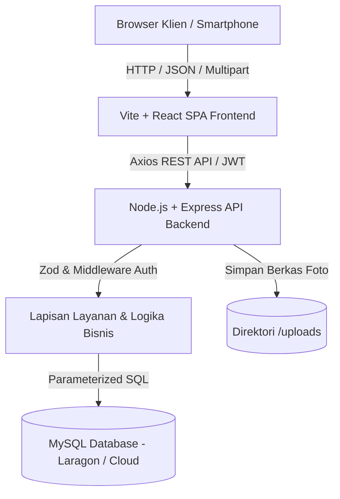
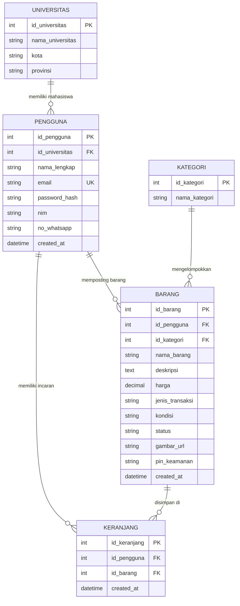

# WarisanKampus: Platform Estafet Barang Mahasiswa Lintas Kampus

Platform web *marketplace* dan estafet perlengkapan kuliah (*preloved*, barter, dan hibah) antar-mahasiswa lintas perguruan tinggi di seluruh Indonesia.

---

## 1. Tentang Proyek

**WarisanKampus** adalah platform yang memfasilitasi mahasiswa untuk melakukan transaksi jual beli barang bekas layak pakai (*preloved*), tukar tambah (*barter*), hingga pembagian barang secara cuma-cuma (*hibah*) untuk adik tingkat atau sesama anak kos.

Mengadopsi tradisi *"warisan kating"* yang lekat dengan budaya kampus Indonesia, platform ini hadir untuk membantu mahasiswa menekan pengeluaran kuliah (seperti buku referensi, kalkulator saintifik, jas almamater/lab, perlengkapan kamar kos) sekaligus mendukung perputaran barang yang berkelanjutan (*circular economy*).

---

## 2. Fitur-Fitur Utama

1. **Katalog Barang Terpusat & Responsif:**
   - Menampilkan barang preloved, barter, dan hibah dengan foto, label harga Rupiah, dan status ketersediaan (*Tersedia* / *Sudah Terjual*).
   - Tampilan antarmuka *mobile-first* yang nyaman diakses dari layar smartphone hingga monitor desktop.

2. **Pencarian Cepat & Filter Multi-Kampus per Wilayah:**
   - Filter dropdown 40 perguruan tinggi terkemuka di Indonesia yang dikelompokkan berdasarkan wilayah (Jawa Barat, DKI Jakarta & Banten, DI Yogyakarta, Jawa Tengah, Jawa Timur, Sumatera, Bali & Sulawesi).
   - Filter kategori barang (Buku Kuliah, Elektronik, Perabot Kos, Alat Tulis, Pakaian & Almamater, Lainnya).
   - Pencarian kata kunci dengan penundaan ketik (*debounce*).
   - Sinkronisasi URL query params (`?univ=&kategori=&q=&page=`) agar filter tetap tersimpan saat halaman dimuat ulang.

3. **Autentikasi Akun Mahasiswa (JWT):**
   - Registrasi dan login mahasiswa dengan verifikasi email kampus, nama lengkap, universitas asal, NIM, dan WhatsApp.
   - Proteksi sesi aman menggunakan JSON Web Token (JWT) yang tersimpan di *client storage*.

4. **Keranjang / Daftar Incaran Mahasiswa:**
   - Mahasiswa dapat menandai dan menyimpan barang incaran ke dalam keranjang belanja.
   - Rangkuman estimasi total biaya dan akses cepat untuk menghubungi penjual langsung dari keranjang.

5. **Manajemen Iklan & Otorisasi Ganda (Login / PIN Keamanan):**
   - **Mode Login:** Mahasiswa yang memiliki akun dapat mengelola semua barang dagangannya di halaman *Barang Saya* tanpa perlu memasukkan PIN berulang kali.
   - **Mode Tamu (Guest/PIN):** Mahasiswa tetap bisa mengunggah barang dengan cepat menggunakan **PIN 4-6 digit** terenkripsi bcrypt untuk mengedit atau menghapus iklan jika belum membuat akun.

6. **Formulir Pasang Iklan Barang:**
   - Unggah foto barang (JPG, PNG, WebP maks. 2 MB) lengkap dengan *live image preview*.
   - Otomatisasi harga Rp 0 dan penguncian input harga saat memilih jenis transaksi *Barter* atau *Hibah*.
   - Validasi formulir interaktif di sisi klien (*react-hook-form*) dan verifikasi skema ketat di sisi server (*Zod*).

7. **Integrasi Komunikasi WhatsApp (COD Kampus):**
   - Calon pembeli dapat langsung menekan tombol **Chat WA** untuk menghubungi pemilik barang.
   - Pesan pembuka WhatsApp diformat otomatis secara santun dan terstruktur lengkap dengan judul barang, harga, dan ajakan janji temu (*Cash on Delivery* / COD) di area kampus yang aman.

8. **Halaman Edukasi Keamanan Transaksi & Visi Platform:**
   - Halaman *Tentang WarisanKampus* memuat panduan keselamatan bertransaksi secara COD di lingkungan kampus serta alur kerja platform.

---

## 3. Tech Stack

- **Frontend:**
  - React 18 (Functional Components & Hooks)
  - TypeScript (Strict Mode)
  - Vite (Build Tool & High-performance Dev Server)
  - Tailwind CSS (Utility-first CSS, Mobile-First Layout)
  - React Router DOM v6 (Client-side Routing)
  - React Hook Form (Manajemen State & Validasi Form)
  - Axios (HTTP Client REST API)
  - Lucide React (Paket Ikon Vektor Modern)
- **Backend:**
  - Node.js & Express (RESTful API Server)
  - TypeScript (Strict Typing)
  - MySQL2 / Promise (Connection Pool)
  - Zod (Validasi Skema Request Body, Query, & Params)
  - Multer (Penanganan Unggah Berkas Gambar)
  - BcryptJS (Hashing Password & PIN Keamanan)
  - JSON Web Token / JWT (Otorisasi Sesi Pengguna)
  - Helmet & CORS (Pengamanan HTTP Header & Whitelist Origin)
- **Database:**
  - MySQL 8.4 InnoDB (Relasional dengan Foreign Keys & CHECK Constraints)

---

## 4. Arsitektur Sistem & Diagram

### A. Arsitektur 3-Tier



### B. Entity Relationship Diagram (ERD)



---

## 5. Cara Menjalankan Proyek Secara Lokal

### Prasyarat
1. **Node.js** versi 18 atau 20+.
2. **MySQL Server** lokal (misalnya Laragon atau XAMPP) aktif pada port 3306 (user default: `root`, password: `""` / kosong).

### Langkah-Langkah:

1. **Clone Repositori:**
   ```bash
   git clone <URL_REPO_GITHUB>
   cd Web_UAS_WaMP
   ```

2. **Inisialisasi Database:**
   - Pastikan MySQL lokal sudah aktif.
   - Jalankan migrasi tabel dan seeding data otomatis:
     ```bash
     npm run db:migrate
     ```
   - Skrip ini otomatis membuat database `campuspreloved`, relasi tabel, data master 40 universitas, kategori, dan barang sampel.

3. **Jalankan Aplikasi:**
   Di folder utama (root), jalankan:
   ```bash
   npm run dev
   ```
   *Perintah ini akan menyalakan Backend API (port 4000) dan Frontend Vite (port 5173) secara bersamaan menggunakan `concurrently`.*

4. **Buka di Browser:**
   Akses antarmuka web di: **`http://localhost:5173`**

---

## 6. Dokumentasi API (RESTful Endpoints)

Koleksi lengkap pengujian API Postman tersedia di:  
[`docs/campuspreloved.postman_collection.json`](file:///c:/Users/Pavilion/Documents/DOKUMEN%20TUGAS/Kuliah/SEM3/WEB_MOBILE_PROG_SEM3/Web_UAS_WaMP/docs/campuspreloved.postman_collection.json)  
Dokumentasi lengkap kontrak API dapat dibaca di:  
[`docs/API.md`](file:///c:/Users/Pavilion/Documents/DOKUMEN%20TUGAS/Kuliah/SEM3/WEB_MOBILE_PROG_SEM3/Web_UAS_WaMP/docs/API.md)

| Metode | Endpoint | Deskripsi | Otorisasi |
|---|---|---|---|
| `GET` | `/api/universitas` | Daftar seluruh universitas dan provinsinya | Publik |
| `GET` | `/api/kategori` | Daftar master kategori barang | Publik |
| `GET` | `/api/barang` | Daftar barang (filter `id_universitas`, `id_kategori`, `search`, `page`, `limit`) | Publik |
| `GET` | `/api/barang/:id` | Rincian detail barang dan kontak penjual | Publik |
| `POST` | `/api/barang` | Menambahkan barang baru (dukungan upload gambar) | Form + PIN / Auth |
| `PUT` | `/api/barang/:id` | Mengubah rincian barang atau menandai terjual | Auth Bearer / PIN |
| `DELETE` | `/api/barang/:id` | Menghapus iklan barang secara permanen | Auth Bearer / PIN |
| `GET` | `/api/barang/saya` | Daftar barang milik pengguna yang sedang login | Bearer Token (JWT) |
| `POST` | `/api/auth/register` | Pendaftaran akun mahasiswa baru | Publik |
| `POST` | `/api/auth/login` | Masuk ke akun mahasiswa dan memperoleh token JWT | Publik |
| `GET` | `/api/auth/me` | Mengambil data profil pengguna yang sedang login | Bearer Token (JWT) |
| `GET` | `/api/keranjang` | Mengambil daftar barang incaran dan total estimasi harga | Bearer Token (JWT) |
| `POST` | `/api/keranjang/:id` | Menambahkan barang ke daftar keranjang incaran | Bearer Token (JWT) |
| `DELETE` | `/api/keranjang/:id` | Menghapus barang dari daftar keranjang incaran | Bearer Token (JWT) |
| `GET` | `/api/health` | Health check koneksi server dan database | Publik |

---

## 7. Catatan Keamanan & Integritas Data

- **Proteksi Kata Sandi & PIN:** Seluruh kata sandi akun dan PIN verifikasi barang di-hash menggunakan algoritma **bcrypt** dengan salt factor yang aman sebelum masuk ke basis data.
- **Normalisasi Kontak WhatsApp:** Semua nomor telepon otomatis dinormalisasi ke format internasional Indonesia (`628...`) di sisi server sebelum disimpan.
- **Pembersihan Berkas Otomatis:** Saat barang dihapus atau fotonya diganti, foto lama di server (`backend/uploads/`) langsung dibersihkan untuk menghindari penumpukan penyimpanan.
- **Sanitasi & Validasi Kuantitas SQL:** Seluruh interaksi database Express menggunakan *parameterized queries* (`?`) untuk mencegah risiko serangan SQL Injection.

---

## 8. Panduan Deployment ke Cloud

1. **Database:** Gunakan penyedia MySQL Cloud (seperti **Aiven for MySQL**, **Railway**, atau **TiDB Serverless**). Jalankan berkas `database/schema.sql` dan `database/seed.sql`.
2. **Backend:** Deploy folder `backend/` ke **Render** atau **Railway**. Konfigurasikan Environment Variables:
   - `PORT=4000`
   - `DB_HOST=<host_cloud_mysql>`
   - `DB_USER=<user_cloud_mysql>`
   - `DB_PASSWORD=<password_cloud_mysql>`
   - `DB_NAME=campuspreloved`
   - `JWT_SECRET=<kunci_rahasia_jwt>`
   - `CORS_ORIGIN=https://<domain-frontend-anda>.vercel.app`
3. **Frontend:** Deploy folder `frontend/` ke **Vercel** atau **Netlify**. Konfigurasikan Environment Variable:
   - `VITE_API_URL=https://<domain-backend-anda>.onrender.com`

---

## 9. Lisensi

Hak Cipta &copy; 2026 **WarisanKampus**. Dirilis di bawah lisensi [MIT](https://opensource.org/licenses/MIT).
