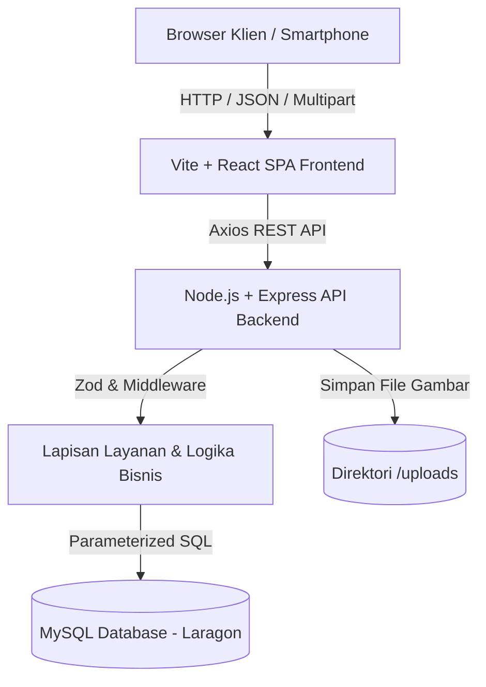
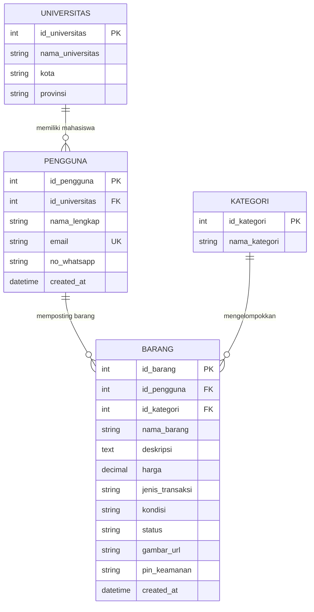

# WarisanKampus: Platform Estafet Barang Mahasiswa Lintas Kampus

> **Tugas Besar Mata Kuliah Web and Mobile Programming (WaMP)**  
> Dibuat oleh: **Muhammad Zidan** (Mahasiswa)

---

## 1. Tentang Proyek

**WarisanKampus** adalah platform berbasis web yang memfasilitasi mahasiswa di seluruh Indonesia untuk melakukan transaksi jual beli barang bekas layak pakai (*preloved*), tukar tambah (*barter*), hingga pembagian barang cuma-cuma (*hibah*) untuk adik tingkat atau sesama anak kos.

Dengan konsep *"warisan kating"* yang sudah mendarah daging dalam budaya kampus Indonesia, platform ini membantu mahasiswa menekan pengeluaran kuliah (buku referensi, kalkulator saintifik, jas almamater/lab, perlengkapan kos) sekaligus mendukung perputaran barang yang berkelanjutan (*circular economy*).

---

## 2. Fitur-Fitur Utama

1. **Katalog Barang Terpusat & Responsif:**
   - Menampilkan barang preloved, barter, dan hibah dengan thumbnail foto, harga Rupiah, dan status ketersediaan (*Tersedia* / *Sudah Terjual*).
   - Tampilan *mobile-first* yang nyaman diakses dari layar smartphone (360px) hingga layar desktop monitor.

2. **Pencarian Cepat & Filter Multi-Kampus per Wilayah:**
   - Filter dropdown 40 perguruan tinggi terkemuka di Indonesia yang dikelompokkan rapi per wilayah (Jawa Barat, DKI Jakarta & Banten, DI Yogyakarta, Jawa Tengah, Jawa Timur, Sumatera, Bali & Sulawesi).
   - Filter kategori barang (Buku Kuliah, Elektronik, Perabot Kos, Alat Tulis, Pakaian & Almamater, Lainnya).
   - Pencarian kata kunci otomatis dengan penundaan ketik (*debounce*).
   - Sinkronisasi URL query params (`?univ=&kategori=&q=&page=`) sehingga filter tidak hilang saat halaman dimuat ulang.

3. **Formulir Pasang Iklan Barang:**
   - Unggah foto barang (JPG, PNG, WebP maksimal 2 MB) lengkap dengan pratinjau (*live image preview*).
   - Otomatisasi harga Rp 0 dan penguncian input saat memilih jenis transaksi *Barter* atau *Hibah*.
   - Validasi formulir interaktif di sisi klien (*react-hook-form*) dan verifikasi skema ketat di sisi server (*Zod*).

4. **Sistem Keamanan PIN Sederhana (Tanpa Login Rumit):**
   - Mahasiswa tidak perlu repot membuat akun atau mengingat kata sandi rumit.
   - Setiap barang dilindungi oleh **PIN angka 4-6 digit** yang di-hash menggunakan algoritma **bcrypt**.
   - PIN ini berfungsi sebagai kunci otorisasi saat pemilik ingin mengubah data barang, menandai barang sudah terjual, atau menghapus iklan.

5. **Integrasi Komunikasi WhatsApp Langsung (COD Kampus):**
   - Calon pembeli dapat langsung menekan tombol **Chat WA** untuk menghubungi pemilik barang.
   - Pesan pembuka WhatsApp diformat secara otomatis dengan salam sopan, nama barang, harga, dan ajakan COD di lingkungan kampus.

---

## 3. Tech Stack

- **Frontend:**
  - React 19 (Strict Mode, Functional Components + Hooks)
  - TypeScript (Strict, Zero `any`)
  - Vite (Build Tool & Dev Server Cepat)
  - Tailwind CSS (Utility-first CSS, Mobile-First, WCAG AA Contrast)
  - React Router DOM v7 (Routing SPA Client-side)
  - React Hook Form (Validasi Formulir)
  - Axios (HTTP Client)
  - Lucide React (Ikon Grafis Modern)
- **Backend:**
  - Node.js & Express (RESTful API Server)
  - TypeScript (Strict Typing)
  - MySQL2 / Promise (Koneksi Database Pool)
  - Zod (Validasi Skema Request Body, Query, & Params)
  - Multer (Penanganan Unggah File Foto)
  - BcryptJS (Hashing PIN Keamanan)
  - Helmet & CORS (Proteksi Header HTTP & Origin Whitelist)
- **Database:**
  - MySQL 8.4 InnoDB (Relasional dengan Foreign Key & CHECK Constraints)

---

## 4. Arsitektur Sistem & Diagram

### A. Arsitektur 3-Tier



### B. Entity Relationship Diagram (ERD)



---

## 5. Cara Menjalankan Proyek Secara Lokal

### Prasyarat
1. **Node.js** versi 18 atau 22+.
2. **Laragon** atau MySQL Server lokal aktif pada port 3306 (user: `root`, password: `""` / kosong).

### Langkah-Langkah:

1. **Clone Repositori:**
   ```bash
   git clone <URL_REPO_GITHUB>
   cd Web_UAS_WaMP
   ```

2. **Inisialisasi Database Laragon:**
   - Pastikan Laragon MySQL sudah berjalan (*Start All*).
   - Jalankan migrasi dan seeding data otomatis:
     ```bash
     npm run db:migrate
     ```
   - Skrip ini akan membuat database `campuspreloved`, tabel-tabel terkait, dan mengisikan data 40 universitas serta data sampel barang.

3. **Jalankan Aplikasi (Satu Perintah Saja):**
   Di folder utama (root), jalankan:
   ```bash
   npm run dev
   ```
   *Perintah ini otomatis menyalakan Backend API (port 4000) dan Frontend Vite (port 5173) secara bersamaan.*

4. **Akses Aplikasi:**
   Buka peramban (browser) ke: **`http://localhost:5173`**

---

## 6. Dokumentasi API (RESTful Endpoints)

Koleksi lengkap pengujian API Postman tersedia di:  
[`docs/campuspreloved.postman_collection.json`](file:///c:/Users/Pavilion/Documents/DOKUMEN%20TUGAS/Kuliah/SEM3/WEB_MOBILE_PROG_SEM3/Web_UAS_WaMP/docs/campuspreloved.postman_collection.json)

| Metode | Endpoint | Deskripsi | Otorisasi |
|---|---|---|---|
| `GET` | `/api/universitas` | Mendapatkan daftar seluruh universitas dan provinsinya | Publik |
| `GET` | `/api/kategori` | Mendapatkan daftar kategori barang | Publik |
| `GET` | `/api/barang` | Mendapatkan daftar barang (mendukung query `id_universitas`, `id_kategori`, `search`, `page`, `limit`) | Publik |
| `GET` | `/api/barang/:id` | Mendapatkan rincian detail barang dan penjual | Publik |
| `POST` | `/api/barang` | Menambahkan barang baru (multipart/form-data) | Form + PIN |
| `PUT` | `/api/barang/:id` | Memperbarui barang atau menandai terjual | Header `X-Item-PIN` / Body `pin` |
| `DELETE` | `/api/barang/:id` | Menghapus iklan barang secara permanen | Header `X-Item-PIN` / Body `pin` |
| `GET` | `/api/health` | Health check koneksi server dan database | Publik |

---

## 7. Catatan Keamanan & Batasan Sistem

- **Sistem Tanpa Login Akun:** Sesuai spesifikasi tugas akhir (MVP), aplikasi tidak menggunakan tabel password pengguna yang rumit. Verifikasi kepemilikan barang ditangani melalui **PIN Keamanan 4-6 Digit** yang dienkripsi dengan bcrypt.
- **Normalisasi Kontak:** Semua nomor telepon WhatsApp otomatis dinormalisasi ke format standar internasional Indonesia (`628...`) sebelum disimpan ke database.
- **Pembersihan Berkas:** Saat barang dihapus atau fotonya diperbarui, berkas foto lama di server otomatis dihapus dari direktori `backend/uploads/` untuk mencegah penumpukan sampah penyimpanan.

---

## 8. Panduan Deployment ke Cloud

Untuk mempublikasikan aplikasi ke internet:
1. **Database:** Gunakan layanan MySQL Cloud gratis seperti **Aiven for MySQL**, **Railway**, atau **TiDB Serverless**. Import file `database/schema.sql` dan `database/seed.sql`.
2. **Backend:** Deploy folder `backend/` ke **Render** atau **Railway**. Tambahkan Environment Variables:
   - `PORT=4000`
   - `DB_HOST=<host_cloud_mysql>`
   - `DB_USER=<user_cloud_mysql>`
   - `DB_PASSWORD=<password_cloud_mysql>`
   - `DB_NAME=campuspreloved`
   - `CORS_ORIGIN=https://<domain-frontend-anda>.vercel.app`
3. **Frontend:** Deploy folder `frontend/` ke **Vercel** atau **Netlify**. Tambahkan Environment Variable:
   - `VITE_API_URL=https://<domain-backend-anda>.onrender.com`

---

## 9. Lisensi & Hak Cipta

Dibuat untuk memenuhi Tugas Besar Mata Kuliah **Web and Mobile Programming (WaMP) Semester 3**.  
Hak Cipta &copy; 2026 **WarisanKampus**. Semua Hak Dilindungi.
